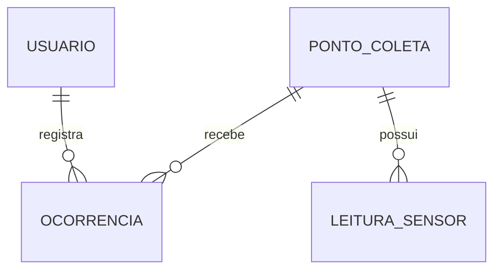

# Binova — API .NET ♻️

**FIAP | Global Solution 2026/2 — CitizenTech**  
**Disciplina:** Advanced Business Development with .NET  
**Repositório:** https://github.com/GustavoSiciliano/GlobalSolution_NET_2026

## 1. Apresentação do projeto

O **Binova** é uma solução tecnológica desenvolvida para auxiliar no monitoramento de lixeiras comunitárias e no acompanhamento de problemas relacionados ao descarte de resíduos.

O sistema permite cadastrar pontos de coleta, registrar medições realizadas por sensores e acompanhar ocorrências comunicadas pelos cidadãos. Com essas informações, a proposta busca facilitar a identificação de lixeiras próximas da capacidade máxima e contribuir para a organização dos serviços de coleta.

A API desta disciplina foi desenvolvida com **ASP.NET Core 8**, utilizando controllers, Entity Framework Core e banco de dados Oracle. Sua função é disponibilizar os recursos do Binova por meio de endpoints REST, permitindo a consulta, o cadastro, a atualização e a exclusão de registros.

O projeto integra a proposta da Global Solution 2026/2, cujo tema é **CitizenTech**, e mantém o mesmo domínio utilizado nas demais disciplinas da equipe.

## 2. Integrantes

| Integrante | RM |
|---|---|
| Gustavo de Jesus | 567926 |
| Gustavo Siciliano | 568419 |
| Samuel Keniti | 567614 |
| Manuel Pedro | 567458 |
| Vinicius Morrone | 566884 |

**Instituição:** FIAP  
**Curso:** Análise e Desenvolvimento de Sistemas  
**Turma:** a preencher conforme o cadastro oficial da equipe.

## 3. Tecnologias utilizadas

O desenvolvimento utiliza as seguintes tecnologias:

- **C# e .NET 8:** linguagem e plataforma de desenvolvimento.
- **ASP.NET Core Web API:** construção dos endpoints REST com controllers.
- **Entity Framework Core 8:** mapeamento das entidades e acesso aos dados.
- **Oracle.EntityFrameworkCore 8:** integração do Entity Framework Core com o Oracle.
- **Oracle Database:** armazenamento dos dados do sistema.
- **EF Core Migrations:** controle das alterações realizadas na estrutura do banco.
- **Git e GitHub:** versionamento e compartilhamento do projeto.

### Banco de dados Oracle

| Configuração | Valor |
|---|---|
| Servidor | `oracle.fiap.com.br` |
| Porta | `1521` |
| Serviço | `orcl` |
| Banco | Oracle da FIAP |

A conexão deve utilizar o mesmo usuário Oracle em que os scripts de Banco de Dados do Binova foram executados.

Por segurança, a senha não é armazenada no repositório.

## 4. Modelo de dados

A API utiliza quatro entidades principais: **Usuário, Ponto de Coleta, Leitura de Sensor e Ocorrência**.

Essas entidades representam os cidadãos e responsáveis pelo sistema, os locais de descarte monitorados, as medições dos sensores e os problemas relatados.

### 4.1 Entidades

| Entidade | Responsabilidade |
|---|---|
| `USUARIO` | Armazena os usuários cadastrados e seus respectivos papéis. |
| `PONTO_COLETA` | Identifica as lixeiras e suas características. |
| `LEITURA_SENSOR` | Registra o histórico de medições dos sensores. |
| `OCORRENCIA` | Armazena os relatos de problemas associados aos pontos de coleta. |

### 4.2 Relacionamentos

O modelo utiliza relacionamentos do tipo **um para muitos (1:N)**:

- Um usuário pode registrar diversas ocorrências.
- Um ponto de coleta pode receber várias leituras.
- Um ponto de coleta pode possuir diferentes ocorrências.



### 4.3 Campos principais

**USUARIO**

- `ID`
- `NOME`
- `EMAIL`
- `SENHA_HASH`
- `PAPEL`
- `CRIADO_EM`

**PONTO_COLETA**

- `ID`
- `NOME`
- `DESCRICAO_LOCALIZACAO`
- `CAPACIDADE_LITROS`
- `ATIVO`
- `CRIADO_EM`

**LEITURA_SENSOR**

- `ID`
- `PONTO_COLETA_ID`
- `DISTANCIA_CM`
- `NIVEL_PERCENTUAL`
- `REGISTRADO_EM`

**OCORRENCIA**

- `ID`
- `PONTO_COLETA_ID`
- `USUARIO_ID`
- `TIPO`
- `DESCRICAO`
- `STATUS`
- `CRIADO_EM`
- `ATUALIZADO_EM`

Os campos de data utilizam `TIMESTAMP WITH TIME ZONE`, conforme o modelo Oracle do projeto.

## 5. Integração com o banco existente

A API .NET foi preparada para utilizar as mesmas tabelas criadas na disciplina de Banco de Dados.

Dessa forma, não é necessário manter uma segunda estrutura com tabelas específicas para .NET. A proposta é aproveitar os registros já existentes e permitir que a aplicação consulte e manipule essas informações.

As tabelas utilizadas são:

- `USUARIO`
- `PONTO_COLETA`
- `LEITURA_SENSOR`
- `OCORRENCIA`

A estrutura do projeto prevê a preservação das tabelas e de seus registros. A criação de novos identificadores é feita por meio de sequências Oracle, planejadas para iniciar após os maiores IDs existentes.

**Importante:** a conexão com o banco e o comportamento das Migrations ainda precisam ser validados no ambiente Oracle da equipe. Antes de aplicar alterações, é necessário conferir a estrutura atual para evitar modificações indevidas.

## 6. Migrations

O Entity Framework Core utiliza Migrations para registrar as alterações previstas na estrutura do banco.

A Migration inicial do projeto é:

`20261109000100_CriacaoInicial`

Ela foi preparada para considerar a existência prévia das tabelas do Binova.

O comportamento previsto é:

1. Preservar as tabelas que já existem no schema.
2. Criar as tabelas ausentes, conforme a estrutura definida.
3. Preparar sequências para a geração dos novos IDs.
4. Registrar o histórico técnico das Migrations em `BINOVA_EF_MIGRATIONS`.

As quatro sequências auxiliares devem considerar os identificadores já utilizados, evitando conflitos com os registros anteriores.

A Migration não possui uma reversão destrutiva, pois o banco também é utilizado pela disciplina de Banco de Dados.

**Não execute comandos `DROP TABLE` para instalar ou testar a API.**

Antes de aplicar a Migration, recomenda-se verificar seu código, conferir as tabelas existentes e validar a operação em um ambiente de testes.

## 7. Estrutura do projeto

O repositório está organizado para separar a configuração da aplicação, o acesso aos dados, as entidades e os endpoints.

```text
GlobalSolution_NET_2026/
│
├── Binova.Api.csproj
├── Binova.sln
├── Program.cs
├── appsettings.json
├── appsettings.Development.example.json
├── .gitignore
├── README.md
│
├── Dados/
│   ├── BinovaDbContext.cs
│   └── BinovaDbContextFactory.cs
│
├── Modelos/
│   └── Entidades.cs
│
├── Contratos/
│   └── Entradas.cs
│
├── Controllers/
│   ├── UsuariosController.cs
│   ├── PontosColetaController.cs
│   ├── LeiturasSensorController.cs
│   └── OcorrenciasController.cs
│
├── Migrations/
│   ├── 20261109000100_CriacaoInicial.cs
│   ├── 20261109000100_CriacaoInicial.Designer.cs
│   └── BinovaDbContextModelSnapshot.cs
│
├── Servicos/
│   ├── SenhaService.cs
│   └── SequenciaService.cs
│
└── scripts/
    ├── Verificar-Banco.sql
    ├── testar-api.http
    └── Testar-CRUD.ps1
```

### Responsabilidade das pastas

| Pasta | Finalidade |
|---|---|
| `Dados` | Configuração do DbContext e acesso ao Oracle. |
| `Modelos` | Entidades utilizadas pela aplicação. |
| `Contratos` | Modelos de entrada e validação dos dados recebidos. |
| `Controllers` | Endpoints HTTP e operações de cada recurso. |
| `Migrations` | Controle das alterações da estrutura do banco. |
| `Servicos` | Funções auxiliares, como tratamento de senhas e geração de IDs. |
| `scripts` | Consultas SQL e roteiros de teste da API. |

## 8. Configuração do ambiente

### 8.1 Pré-requisitos

Para executar o projeto, são necessários:

- .NET SDK 8 instalado.
- Acesso ao banco Oracle da FIAP.
- Credenciais de um usuário com as permissões necessárias.
- Acesso à internet ou à rede exigida pela FIAP para a conexão com o Oracle.
- Terminal PowerShell ou equivalente.

### 8.2 Configurar a conexão Oracle

Na pasta principal do projeto, execute:

```powershell
Copy-Item appsettings.Development.example.json appsettings.Development.json
```

Depois, edite o arquivo `appsettings.Development.json` e configure a conexão com o Oracle utilizando as credenciais da equipe.

Como alternativa, a connection string pode ser fornecida pela variável de ambiente:

`ConnectionStrings__Oracle`

O arquivo `appsettings.Development.json` deve permanecer apenas no computador utilizado para os testes.

**Nunca envie a senha do Oracle para o GitHub.**

### 8.3 Restaurar e compilar

Na raiz do projeto, execute:

```powershell
dotnet --version
dotnet tool restore
dotnet restore
dotnet build
```

O comando de compilação deverá concluir sem erros antes da execução da API.

### 8.4 Conferir as Migrations

Para listar as Migrations disponíveis:

```powershell
dotnet ef migrations list
```

Após verificar a conexão com o Oracle e revisar as alterações previstas, aplique a Migration no ambiente adequado:

```powershell
dotnet ef database update
```

Como o schema contém tabelas utilizadas por outra disciplina, essa etapa exige atenção para preservar os dados existentes.

### 8.5 Iniciar a aplicação

Execute:

```powershell
dotnet run --launch-profile http
```

O endereço HTTP configurado para o projeto é:

http://localhost:5086

## 9. Endpoints da API

A API disponibiliza operações CRUD para as quatro entidades principais.

| Recurso | Rota principal | Métodos |
|---|---|---|
| Usuários | `/api/usuarios` | GET, POST, PUT, DELETE |
| Pontos de coleta | `/api/pontos-coleta` | GET, POST, PUT, DELETE |
| Leituras de sensores | `/api/leituras-sensor` | GET, POST, PUT, DELETE |
| Ocorrências | `/api/ocorrencias` | GET, POST, PUT, DELETE |

Cada recurso oferece consulta da lista e consulta individual por ID.

### 9.1 Códigos HTTP

Os endpoints seguem os códigos HTTP definidos no enunciado da disciplina:

| Código | Significado | Utilização |
|---|---|---|
| `200 OK` | Requisição realizada com sucesso | Consultas GET |
| `201 Created` | Recurso criado | Cadastro POST |
| `204 No Content` | Operação concluída sem corpo de resposta | Atualização PUT e exclusão DELETE |
| `400 Bad Request` | Dados inválidos | Falha de validação |
| `404 Not Found` | Recurso não encontrado | Consulta ou alteração de ID inexistente |

As respostas de erro são apresentadas em JSON, facilitando a identificação do problema encontrado durante os testes.

### 9.2 Consulta da situação dos pontos

Além do CRUD, a API disponibiliza:

`GET /api/pontos-coleta/{id}/situacao`

Esse endpoint consulta a última leitura do ponto de coleta e informa a condição de preenchimento da lixeira.

| Percentual | Situação |
|---|---|
| Abaixo de 50% | `DISPONIVEL` |
| De 50% até menos de 80% | `ATENCAO` |
| A partir de 80% | `PROXIMA_DO_LIMITE` |
| Leitura desatualizada ou ausente | `SEM_DADOS_ATUALIZADOS` |

Uma leitura é considerada recente quando foi registrada nos últimos 15 minutos.

Essa classificação auxilia na identificação de pontos que podem exigir atenção da equipe responsável pela coleta.

## 10. Testes da API

Os testes devem verificar o funcionamento dos endpoints, a persistência dos dados no Oracle e o tratamento das respostas HTTP.

### 10.1 Verificar os dados existentes

Antes de cadastrar novos registros, consulte os seguintes endpoints:

```http
GET http://localhost:5086/api/usuarios

GET http://localhost:5086/api/pontos-coleta?incluirInativos=true

GET http://localhost:5086/api/leituras-sensor

GET http://localhost:5086/api/ocorrencias
```

Se a API estiver conectada ao mesmo schema utilizado na disciplina de Banco de Dados, os registros anteriormente cadastrados deverão aparecer nas respostas.

O arquivo `scripts/Verificar-Banco.sql` também pode ser executado no Oracle SQL Developer para conferir as informações diretamente no banco.

### 10.2 Testar as operações CRUD

O projeto disponibiliza um roteiro de testes em PowerShell:

```powershell
.\scripts\Testar-CRUD.ps1
```

O script foi preparado para executar operações de cadastro, consulta, atualização e exclusão, além de verificar os principais códigos HTTP.

**Atenção:** esses testes podem modificar registros reais no schema compartilhado. Recomenda-se executá-los somente no ambiente acadêmico e conferir antecipadamente os registros envolvidos.

A exclusão de pontos de coleta utiliza desativação lógica para preservar o histórico associado.

### 10.3 Testar erros de validação

O arquivo `scripts/testar-api.http` contém requisições que permitem verificar situações como:

- Envio de dados obrigatórios vazios.
- Valores numéricos fora dos limites permitidos.
- Consulta de IDs inexistentes.
- Tentativa de vincular registros a entidades não encontradas.

Para dados inválidos, a API deverá retornar `400 Bad Request`. Para recursos inexistentes, o retorno esperado é `404 Not Found`.

## 11. Integração com as demais disciplinas

O Binova foi desenvolvido como uma proposta única para a Global Solution, permitindo que cada disciplina trabalhe uma parte da solução.

A API .NET utiliza o mesmo domínio de dados das demais entregas, mas possui implementação própria.

| Disciplina | Relação com o Binova |
|---|---|
| Java Advanced | API REST com autenticação, regras de negócio e consultas. |
| Banco de Dados | Modelagem Oracle e implementação SQL/PLSQL. |
| Mobile | Aplicativo para consulta dos pontos de coleta e registro de informações. |
| IoT | Medição do preenchimento das lixeiras por sensores. |
| DevOps | Preparação do ambiente, containers e execução da aplicação. |
| QA | Modelagem da arquitetura e análise da solução. |

O compartilhamento do domínio facilita a integração conceitual entre as entregas. Cada aplicação pode utilizar sua própria infraestrutura, conforme os requisitos da disciplina.

## 12. Requisitos de avaliação da FIAP

A implementação foi organizada considerando os critérios definidos para Advanced Business Development with .NET.

| Critério | Pontuação | Arquivos relacionados |
|---|---:|---|
| API REST em ASP.NET Core 8 | 20 | `Program.cs` e `Controllers/` |
| Entidades relacionadas e validações | 20 | `Modelos/`, `Contratos/` e `Dados/` |
| Entity Framework Core, Oracle e Migrations | 25 | `Dados/` e `Migrations/` |
| CRUD completo e respostas HTTP | 20 | `Controllers/` |
| Tratamento de erros 400 e 404 | 10 | `Contratos/` e `Controllers/` |
| Documentação do projeto | 5 | `README.md` |
| **Total** | **100** | |

A presença desses recursos no código não substitui a validação prática. O funcionamento deverá ser demonstrado durante os testes e na apresentação da disciplina.

## 13. Entrega da disciplina

A entrega de .NET deverá conter:

1. **Repositório público no GitHub:** projeto na raiz, código-fonte, `.gitignore` e Migrations versionadas.
2. **README.md:** apresentação do projeto, integrantes, diagrama das entidades, instruções de execução e testes.
3. **Vídeo demonstrativo de até cinco minutos:** execução do CRUD e apresentação dos dados armazenados no Oracle.
4. **Arquivo `.txt` no Portal FIAP:** nome, RM e turma dos integrantes, link do GitHub e link do vídeo.

Os diretórios `bin/` e `obj/` não devem ser enviados ao repositório.

## 14. Situação do desenvolvimento

O código-fonte e a estrutura inicial da API .NET estão preparados para a etapa de validação.

Ainda precisam ser confirmados no computador da equipe:

- Compilação do projeto com .NET 8.
- Conexão com o banco Oracle da FIAP.
- Aplicação segura das Migrations.
- Consulta dos registros existentes.
- Funcionamento completo do CRUD.
- Respostas de validação e tratamento de erros.
- Gravação do vídeo demonstrativo.

Essas verificações serão realizadas antes da entrega definitiva.

## 15. Considerações finais

A API .NET representa a camada de acesso aos dados do Binova, permitindo organizar informações sobre os pontos de coleta, as leituras dos sensores e as ocorrências registradas.

A utilização do ASP.NET Core, Entity Framework Core e Oracle atende à proposta técnica da disciplina e permite trabalhar com entidades relacionadas, persistência de dados e operações REST.

Além de demonstrar os conceitos abordados durante as aulas, o projeto contribui para a proposta geral do Binova: utilizar a tecnologia para apoiar uma gestão mais organizada dos resíduos e melhorar o acompanhamento das condições dos pontos de coleta.

---

**Observação de segurança:** a API não implementa autenticação nesta versão, pois esse recurso não é obrigatório para a entrega de .NET. Seu uso deve permanecer restrito ao ambiente acadêmico de desenvolvimento e testes. Credenciais, arquivos locais de configuração e demais informações sensíveis não devem ser publicados no GitHub.