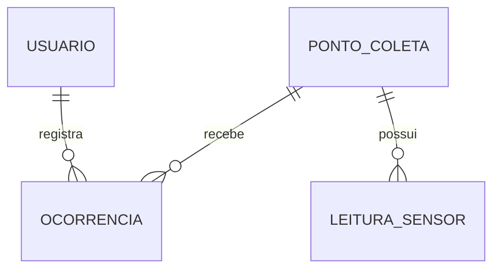

# Binova - API .NET ♻️

**FIAP | Global Solution 2026/2 - CitizenTech**  
**Disciplina:** Advanced Business Development with .NET  
**Repositório:** https://github.com/GustavoSiciliano/GlobalSolution_NET_2026  
**Vídeo:** https://youtu.be/4oG6erDvQaQ


> **Para o professor - roteiro de avaliação manual:** siga a [configuração e execução](#8-configuração-do-ambiente) e, com a API aberta, use o [roteiro completo de testes](#10-roteiro-de-avaliação-manual). Os exemplos criam seus próprios dados; não dependem dos IDs existentes no banco.

**Resumo da execução (PowerShell, na raiz do repositório):**

```powershell
$env:DOTNET_ENVIRONMENT = "Development"
$env:ASPNETCORE_ENVIRONMENT = "Development"
dotnet tool restore
dotnet restore .\Binova.Api.csproj
dotnet build .\Binova.Api.csproj
dotnet ef migrations list --project .\Binova.Api.csproj --startup-project .\Binova.Api.csproj
dotnet run --project .\Binova.Api.csproj
```

**Apenas em um schema de avaliação onde a Migration ainda não foi aplicada e com a conexão funcionando**, execute `dotnet ef database update --project .\Binova.Api.csproj --startup-project .\Binova.Api.csproj`, conforme a seção 8.5. Não execute essa atualização indiscriminadamente em uma conta compartilhada.

Antes dos comandos, configure o Oracle em `appsettings.Development.json` e certifique-se de usar uma conta de teste autorizada. O último comando mantém a API ligada em `http://localhost:5086`; abra outro terminal para chamar os endpoints.

## 1. Apresentação do projeto

O **Binova** é uma solução tecnológica desenvolvida para auxiliar no monitoramento de lixeiras comunitárias e no acompanhamento de problemas relacionados ao descarte de resíduos.

O sistema permite cadastrar pontos de coleta, registrar medições realizadas por sensores e acompanhar ocorrências comunicadas pelos cidadãos. Com essas informações, a proposta busca facilitar a identificação de lixeiras próximas da capacidade máxima e contribuir para a organização dos serviços de coleta.

A API desta disciplina foi desenvolvida com **ASP.NET Core 8**, utilizando controllers, Entity Framework Core e banco de dados Oracle. Sua função é disponibilizar os recursos do Binova por meio de endpoints REST, permitindo a consulta, o cadastro, a atualização e a exclusão de registros.

O projeto integra a proposta da Global Solution 2026/2, cujo tema é **CitizenTech**, e mantém o mesmo domínio utilizado nas demais disciplinas da equipe.

## 2. Integrantes

| Integrante | RM |
|---|---|
| Gustavo de Jesus | 567926 |
| Gustavo Siciliano | 568419 |
| Samuel Keniti | 567614 |
| Manuel Pedro | 567458 |
| Vinicius Morrone | 566884 |

**Instituição:** FIAP  
**Curso:** Análise e Desenvolvimento de Sistemas  
**Turma:** 2TDSPS

## 3. Tecnologias utilizadas

O desenvolvimento utiliza as seguintes tecnologias:

- **C# e .NET 8:** linguagem e plataforma de desenvolvimento.
- **ASP.NET Core Web API:** construção dos endpoints REST com controllers.
- **Entity Framework Core 8:** mapeamento das entidades e acesso aos dados.
- **Oracle.EntityFrameworkCore 8:** integração do Entity Framework Core com o Oracle.
- **Oracle Database:** armazenamento dos dados do sistema.
- **EF Core Migrations:** controle das alterações realizadas na estrutura do banco.
- **Git e GitHub:** versionamento e compartilhamento do projeto.

### Banco de dados Oracle

| Configuração | Valor |
|---|---|
| Servidor | `oracle.fiap.com.br` |
| Porta | `1521` |
| Serviço | `orcl` |
| Banco | Oracle da FIAP |

A API deve acessar um schema Oracle com as quatro tabelas do Binova.

## 4. Modelo de dados

A API utiliza quatro entidades principais: **Usuário, Ponto de Coleta, Leitura de Sensor e Ocorrência**.

Essas entidades representam os cidadãos e responsáveis pelo sistema, os locais de descarte monitorados, as medições dos sensores e os problemas relatados.

### 4.1 Entidades

| Entidade | Responsabilidade |
|---|---|
| `USUARIO` | Armazena os usuários cadastrados e seus respectivos papéis. |
| `PONTO_COLETA` | Identifica as lixeiras e suas características. |
| `LEITURA_SENSOR` | Registra o histórico de medições dos sensores. |
| `OCORRENCIA` | Armazena os relatos de problemas associados aos pontos de coleta. |

### 4.2 Relacionamentos

O modelo utiliza relacionamentos do tipo **um para muitos (1:N)**:

- Um usuário pode registrar diversas ocorrências.
- Um ponto de coleta pode receber várias leituras.
- Um ponto de coleta pode possuir diferentes ocorrências.



### 4.3 Campos principais

**USUARIO**

- `ID`
- `NOME`
- `EMAIL`
- `SENHA_HASH`
- `PAPEL`
- `CRIADO_EM`

**PONTO_COLETA**

- `ID`
- `NOME`
- `DESCRICAO_LOCALIZACAO`
- `CAPACIDADE_LITROS`
- `ATIVO`
- `CRIADO_EM`

**LEITURA_SENSOR**

- `ID`
- `PONTO_COLETA_ID`
- `DISTANCIA_CM`
- `NIVEL_PERCENTUAL`
- `REGISTRADO_EM`

**OCORRENCIA**

- `ID`
- `PONTO_COLETA_ID`
- `USUARIO_ID`
- `TIPO`
- `DESCRICAO`
- `STATUS`
- `CRIADO_EM`
- `ATUALIZADO_EM`

Os campos de data utilizam `TIMESTAMP WITH TIME ZONE`, conforme o modelo Oracle do projeto.

## 5. Integração com o banco

A API .NET utiliza a mesma estrutura de tabelas definida na disciplina de Banco de Dados.

Dessa forma, não é necessário manter uma segunda estrutura com tabelas específicas para .NET. A proposta é aproveitar os registros já existentes e permitir que a aplicação consulte e manipule essas informações.

As tabelas utilizadas são:

- `USUARIO`
- `PONTO_COLETA`
- `LEITURA_SENSOR`
- `OCORRENCIA`

A Migration inicial pode criar as tabelas em um schema ainda vazio ou reconhecer tabelas que já existam. Os novos identificadores são gerados por sequências Oracle. Se o schema já contém dados, confira as sequências e as estruturas antes de aplicar mudanças.

## 6. Migrations

O Entity Framework Core utiliza Migrations para registrar as alterações previstas na estrutura do banco.

A Migration inicial do projeto é:

`20261109000100_CriacaoInicial`

Ela foi preparada para considerar a existência prévia das tabelas do Binova.

O comportamento previsto é:

1. Preservar as tabelas que já existem no schema.
2. Criar as tabelas ausentes, conforme a estrutura definida.
3. Preparar sequências para a geração dos novos IDs.
4. Registrar o histórico técnico das Migrations em `BINOVA_EF_MIGRATIONS`.

As quatro sequências auxiliares devem considerar os identificadores já utilizados, evitando conflitos com os registros anteriores.

A Migration não possui uma reversão destrutiva, pois o banco também é utilizado pela disciplina de Banco de Dados.

**Não execute comandos `DROP TABLE` para instalar ou testar a API.**

## 7. Estrutura do projeto

O repositório está organizado para separar a configuração da aplicação, o acesso aos dados, as entidades e os endpoints.

```text
GlobalSolution_NET_2026/
│
├── Binova.Api.csproj
├── .config/
│   └── dotnet-tools.json
├── Binova.sln
├── Program.cs
├── appsettings.json
├── appsettings.Development.example.json
├── .gitignore
├── README.md
│
├── Dados/
│   ├── BinovaDbContext.cs
│   └── BinovaDbContextFactory.cs
│
├── Modelos/
│   └── Entidades.cs
│
├── Contratos/
│   └── Entradas.cs
│
├── Controllers/
│   ├── UsuariosController.cs
│   ├── PontosColetaController.cs
│   ├── LeiturasSensorController.cs
│   └── OcorrenciasController.cs
│
├── Migrations/
│   ├── 20261109000100_CriacaoInicial.cs
│   ├── 20261109000100_CriacaoInicial.Designer.cs
│   └── BinovaDbContextModelSnapshot.cs
│
├── Servicos/
│   ├── SenhaService.cs
│   └── SequenciaService.cs
│
└── scripts/
    ├── Verificar-Banco.sql
    ├── testar-api.http
    └── Testar-CRUD.ps1
```

### Responsabilidade das pastas

| Pasta | Finalidade |
|---|---|
| `Dados` | Configuração do DbContext e acesso ao Oracle. |
| `Modelos` | Entidades utilizadas pela aplicação. |
| `Contratos` | Modelos de entrada e validação dos dados recebidos. |
| `Controllers` | Endpoints HTTP e operações de cada recurso. |
| `Migrations` | Controle das alterações da estrutura do banco. |
| `Servicos` | Funções auxiliares, como tratamento de senhas e geração de IDs. |
| `scripts` | Consultas SQL e roteiros de teste da API. |

## 8. Configuração do ambiente

Este procedimento reproduz o ambiente utilizado nos testes do projeto. Os comandos são para **PowerShell no Windows**, executados na raiz do repositório (pasta que contém `Binova.Api.csproj`).

### 8.1 Pré-requisitos

- .NET SDK compatível com o projeto **.NET 8** (`dotnet --version` para conferir).
- Acesso à rede e ao Oracle da FIAP.
- Conta Oracle própria para avaliação, com permissão para criar as estruturas necessárias.
- PowerShell, Visual Studio ou VS Code; para enviar requisições, PowerShell, Postman ou Insomnia.
- Código-fonte completo do repositório, incluindo a pasta `Migrations` e o manifesto `.config/dotnet-tools.json`.

> O projeto usa **controllers** e **não depende de Swagger**. As operações são testadas pelas URLs HTTP descritas abaixo. Se a porta `5086` já estiver ocupada, encerre a instância anterior da API antes de iniciá-la novamente.

### 8.2 Obter o código e abrir a pasta correta

Faça o clone pelo Git ou baixe o ZIP do GitHub e extraia:

```powershell
git clone https://github.com/GustavoSiciliano/GlobalSolution_NET_2026.git
cd .\GlobalSolution_NET_2026
```

Se utilizou **Download ZIP**, apenas abra o terminal na pasta extraída que contém `Binova.Api.csproj`. Não é necessário executar `git clone` nesse caso.

> Os comandos abaixo indicam o projeto explicitamente porque uma pasta com mais de um `.csproj` ou `.sln` pode fazer `dotnet build` sem argumentos retornar `MSB1011`.

### 8.3 Configurar o acesso ao Oracle

Crie o arquivo local de desenvolvimento a partir do exemplo **somente se ainda não existir**:

```powershell
if (-not (Test-Path .\appsettings.Development.json)) {
    Copy-Item .\appsettings.Development.example.json .\appsettings.Development.json
}
```

Para editar as credenciais pelo terminal, utilize `notepad .\appsettings.Development.json`. Nunca copie o arquivo de exemplo por cima de uma configuração válida sem conferir seu conteúdo.

Abra `appsettings.Development.json` e configure **seu próprio usuário e senha**:

```json
{
  "ConnectionStrings": {
    "Oracle": "User Id=SEU_USUARIO_ORACLE;Password=SUA_SENHA;Data Source=oracle.fiap.com.br:1521/orcl;"
  },
  "Logging": {
    "LogLevel": {
      "Default": "Information",
      "Microsoft.AspNetCore": "Warning"
    }
  },
  "AllowedHosts": "*"
}
```

Use o usuário exato fornecido pela FIAP (inclusive o prefixo `RM`, **se fizer parte do login**). 

No PowerShell do projeto, configure o ambiente antes de aplicar a Migration:

```powershell
$env:DOTNET_ENVIRONMENT = "Development"
$env:ASPNETCORE_ENVIRONMENT = "Development"
```

### 8.4 Restaurar ferramentas e compilar

```powershell
dotnet --version
dotnet tool restore
dotnet restore .\Binova.Api.csproj
dotnet build .\Binova.Api.csproj
```

O esperado é **`Build succeeded` / `Construir êxito`**, sem erros. O projeto usa `dotnet-ef` 8 na configuração local.

### 8.5 Aplicar a Migration no Oracle

**Antes de executar**, confirme que a connection string aponta para a conta Oracle escolhida para o teste. A Migration da entrega utiliza os nomes originais `USUARIO`, `PONTO_COLETA`, `LEITURA_SENSOR` e `OCORRENCIA`.

Confira as Migrations disponíveis:

```powershell
dotnet ef migrations list --project .\Binova.Api.csproj --startup-project .\Binova.Api.csproj
```

**Se a conexão estiver correta e a Migration realmente estiver pendente no schema de testes**, aplique:

```powershell
dotnet ef database update --project .\Binova.Api.csproj --startup-project .\Binova.Api.csproj
```

Se `migrations list` retornar `ORA-01017` ou outra falha de conexão, **interrompa aqui**. A indicação `(Pending)` após falha de autenticação não é uma confirmação confiável de que falta aplicar a Migration.

Na primeira aplicação da Migration, o terminal poderá mostrar:

```text
Build succeeded.
Applying migration '20261109000100_CriacaoInicial'.
Done.
```

Em execuções seguintes, a Migration pode já estar registrada e não ser executada novamente - isso é normal. **`Done.` por si só não comprova a existência das quatro tabelas**; confirme a estrutura no SQL Developer:

```sql
SELECT USER AS USUARIO_ATUAL FROM DUAL;

SELECT TABLE_NAME
FROM USER_TABLES
WHERE TABLE_NAME IN ('USUARIO', 'PONTO_COLETA', 'LEITURA_SENSOR', 'OCORRENCIA')
ORDER BY TABLE_NAME;

SELECT SEQUENCE_NAME
FROM USER_SEQUENCES
WHERE SEQUENCE_NAME IN (
    'BINOVA_USUARIO_SEQ',
    'BINOVA_PONTO_SEQ',
    'BINOVA_LEITURA_SEQ',
    'BINOVA_OCORRENCIA_SEQ'
)
ORDER BY SEQUENCE_NAME;

SELECT * FROM BINOVA_EF_MIGRATIONS;
```

O esperado são **quatro tabelas**, **quatro sequências** e o registro `20261109000100_CriacaoInicial` no histórico. Caso o histórico ainda não exista, revise o resultado da Migration antes de continuar. As consultas SQL devem ser executadas **na mesma conta Oracle configurada na API**.

**Não execute `DROP TABLE` ou `dotnet ef database drop`.** A Migration foi desenvolvida para não eliminar tabelas compartilhadas.

### 8.6 Iniciar a aplicação

Com a compilação bem-sucedida, execute:

```powershell
dotnet run --project .\Binova.Api.csproj
```

O terminal deve mostrar algo semelhante a:

```text
Now listening on: http://localhost:5086
Application started.
```

**Mantenha esse terminal aberto.** Use **outro PowerShell** para os testes. Para encerrar a API depois, utilize `Ctrl + C` no terminal em que ela foi iniciada.

## 9. Endpoints e respostas HTTP

A URL base dos exemplos é `http://localhost:5086/api`. Em Postman ou Insomnia, selecione o método HTTP indicado, informe essa URL e, para POST/PUT, escolha **Body → raw → JSON** com `Content-Type: application/json`.

| Recurso | Listar | Consultar por ID | Criar | Atualizar | Excluir |
|---|---|---|---|---|---|
| Usuários | `GET /usuarios` | `GET /usuarios/{id}` | `POST /usuarios` | `PUT /usuarios/{id}` | `DELETE /usuarios/{id}` |
| Pontos de coleta | `GET /pontos-coleta` | `GET /pontos-coleta/{id}` | `POST /pontos-coleta` | `PUT /pontos-coleta/{id}` | `DELETE /pontos-coleta/{id}` |
| Leituras | `GET /leituras-sensor` | `GET /leituras-sensor/{id}` | `POST /leituras-sensor` | `PUT /leituras-sensor/{id}` | `DELETE /leituras-sensor/{id}` |
| Ocorrências | `GET /ocorrencias` | `GET /ocorrencias/{id}` | `POST /ocorrencias` | `PUT /ocorrencias/{id}` | `DELETE /ocorrencias/{id}` |

Códigos esperados: **GET `200 OK`**, **POST `201 Created`**, **PUT `204 No Content`**, **DELETE `204 No Content`**, dados inválidos **`400 Bad Request`**, registro não encontrado **`404 Not Found`**.

Rotas adicionais:

| Método e rota | Finalidade |
|---|---|
| `GET /pontos-coleta?incluirInativos=true` | Inclui pontos de coleta desativados |
| `GET /pontos-coleta/{id}/situacao` | Situação baseada na última leitura |
| `GET /leituras-sensor?pontoColetaId={id}` | Leituras de um ponto específico |
| `GET /ocorrencias?pontoColetaId={id}` | Ocorrências de um ponto específico |
| `GET /ocorrencias?status=ABERTA` | Ocorrências com status aberto |

A situação de um ponto utiliza a última leitura: abaixo de 50% é `DISPONIVEL`; de 50% até menos de 80% é `ATENCAO`; a partir de 80% é `PROXIMA_DO_LIMITE`. Uma leitura ausente ou com mais de 15 minutos resulta em `SEM_DADOS_ATUALIZADOS`. A classificação depende do horário da consulta.

## 10. Roteiro de avaliação manual

O roteiro permite reproduzir **GET, POST, PUT e DELETE para todas as quatro entidades**, além de testar **400 e 404**, sem depender de registros preexistentes. Utilize um **schema Oracle de testes**, pois as operações alteram dados. O teste completo usa dois terminais: um para a API e outro para as requisições.

### 10.1 Preparar o segundo terminal

Abra outro PowerShell e defina a URL base:

```powershell
$ErrorActionPreference = "Stop"
$baseUrl = "http://localhost:5086/api"
```

**Execute todos os próximos blocos no mesmo segundo terminal**, para reutilizar as variáveis que guardam os IDs de cada novo registro. Se usar Postman, copie os mesmos JSONs e **anote o campo `id` da resposta de cada POST** para utilizar nos PUTs e DELETEs.

### 10.2 GET - conferir que a API responde

```powershell
Invoke-RestMethod "$baseUrl/usuarios"
Invoke-RestMethod "$baseUrl/pontos-coleta"
Invoke-RestMethod "$baseUrl/pontos-coleta?incluirInativos=true"
Invoke-RestMethod "$baseUrl/leituras-sensor"
Invoke-RestMethod "$baseUrl/ocorrencias"
```

**Resultado esperado:** todas as chamadas retornam HTTP `200`, inclusive quando as listas estão vazias. O GET de pontos sem parâmetro mostra apenas os ativos.

### 10.3 POST - criar quatro registros relacionados

A ordem é importante: **usuário → ponto de coleta → leitura → ocorrência**. Cada POST deve retornar **`201 Created`** e o `id` recém-criado. Os exemplos JSON a seguir também podem ser copiados diretamente para o Postman.

**POST 1 - Usuário** (`POST /api/usuarios`):

```json
{
  "nome": "Usuario Avaliacao Binova",
  "email": "avaliacao.binova123@example.com",
  "senha": "Teste123456!",
  "papel": "CIDADAO"
}
```

No PowerShell, utilize um e-mail único para permitir repetir o teste sem conflito de duplicidade:

```powershell
$emailTeste = "binova.$([guid]::NewGuid().ToString('N').Substring(0,8))@example.com"
$usuarioBody = @{
    nome = "Usuario Avaliacao Binova"
    email = $emailTeste
    senha = "Teste123456!"
    papel = "CIDADAO"
} | ConvertTo-Json

$usuarioCriado = Invoke-RestMethod -Uri "$baseUrl/usuarios" -Method Post `
    -ContentType "application/json" -Body $usuarioBody
"Usuario criado - ID: $($usuarioCriado.id)"
```

**POST 2 - Ponto de coleta** (`POST /api/pontos-coleta`):

```json
{
  "nome": "Ecoponto de Avaliacao",
  "descricaoLocalizacao": "Entrada principal da faculdade",
  "capacidadeLitros": 200,
  "ativo": true
}
```

```powershell
$pontoBody = @{
    nome = "Ecoponto de Avaliacao"
    descricaoLocalizacao = "Entrada principal da faculdade"
    capacidadeLitros = 200
    ativo = $true
} | ConvertTo-Json

$pontoCriado = Invoke-RestMethod -Uri "$baseUrl/pontos-coleta" -Method Post `
    -ContentType "application/json" -Body $pontoBody
"Ponto criado - ID: $($pontoCriado.id)"
```

**POST 3 - Leitura do sensor** (`POST /api/leituras-sensor`): a leitura precisa do ID do ponto que acabou de ser criado.

```json
{
  "pontoColetaId": 11,
  "distanciaCm": 25.5,
  "nivelPercentual": 75
}
```

**O `11` acima é apenas um exemplo de ID para o Postman. Substitua pelo `id` retornado no POST do ponto de coleta.** No PowerShell, a referência é preenchida automaticamente:

```powershell
$leituraBody = @{
    pontoColetaId = $pontoCriado.id
    distanciaCm = 25.5
    nivelPercentual = 75
} | ConvertTo-Json

$leituraCriada = Invoke-RestMethod -Uri "$baseUrl/leituras-sensor" -Method Post `
    -ContentType "application/json" -Body $leituraBody
"Leitura criada - ID: $($leituraCriada.id)"
```

**POST 4 - Ocorrência** (`POST /api/ocorrencias`): depende de um ponto ativo e de um usuário válido.

```json
{
  "usuarioId": 12,
  "pontoColetaId": 11,
  "tipo": "LIXEIRA_CHEIA",
  "descricao": "Ponto de coleta necessita de recolhimento."
}
```

**Os IDs `12` e `11` acima também são ilustrativos.** No Postman, substitua pelos IDs retornados. No PowerShell:

```powershell
$ocorrenciaBody = @{
    usuarioId = $usuarioCriado.id
    pontoColetaId = $pontoCriado.id
    tipo = "LIXEIRA_CHEIA"
    descricao = "Ponto de coleta necessita de recolhimento."
} | ConvertTo-Json

$ocorrenciaCriada = Invoke-RestMethod -Uri "$baseUrl/ocorrencias" -Method Post `
    -ContentType "application/json" -Body $ocorrenciaBody
"Ocorrencia criada - ID: $($ocorrenciaCriada.id)"
```

Confirme os quatro IDs criados:

```powershell
"Usuario: $($usuarioCriado.id)"
"Ponto de coleta: $($pontoCriado.id)"
"Leitura: $($leituraCriada.id)"
"Ocorrencia: $($ocorrenciaCriada.id)"
```

### 10.4 GET por ID - conferir os cadastros

```powershell
Invoke-RestMethod "$baseUrl/usuarios/$($usuarioCriado.id)"
Invoke-RestMethod "$baseUrl/pontos-coleta/$($pontoCriado.id)"
Invoke-RestMethod "$baseUrl/leituras-sensor/$($leituraCriada.id)"
Invoke-RestMethod "$baseUrl/ocorrencias/$($ocorrenciaCriada.id)"
Invoke-RestMethod "$baseUrl/pontos-coleta/$($pontoCriado.id)/situacao"
```

**Resultado esperado:** `200 OK`. Os IDs e dados devem corresponder aos POSTs. Logo após registrar uma leitura de 75%, o endpoint de situação pode exibir `ATENCAO`; se a leitura já estiver desatualizada, apresentará `SEM_DADOS_ATUALIZADOS`.

### 10.5 PUT - atualizar os mesmos quatro registros

Execute na ordem desejada. Cada `PUT` deve retornar **`204 No Content`**. Em PowerShell, esse status normalmente não exibe corpo de resposta; o comando só apresenta saída em caso de erro ou se for feita outra consulta.

**Antes de atualizar, confira os IDs:**

```powershell
if (-not ($usuarioCriado.id -and $pontoCriado.id -and $leituraCriada.id -and $ocorrenciaCriada.id)) {
    throw "IDs ausentes. Execute os quatro POSTs no mesmo terminal antes dos PUTs."
}
```

**PUT 1 - Usuário** (`PUT /api/usuarios/{id}`), sem enviar senha:

```json
{
  "nome": "Usuario Avaliacao Atualizado",
  "email": "avaliacao.binova123@example.com",
  "papel": "CIDADAO"
}
```

```powershell
$usuarioAtualizacao = @{
    nome = "Usuario Avaliacao Atualizado"
    email = $emailTeste
    papel = "CIDADAO"
} | ConvertTo-Json

Invoke-RestMethod -Uri "$baseUrl/usuarios/$($usuarioCriado.id)" -Method Put `
    -ContentType "application/json" -Body $usuarioAtualizacao
"PUT usuario concluido"
```

**PUT 2 - Ponto de coleta** (`PUT /api/pontos-coleta/{id}`):

```json
{
  "nome": "Ecoponto de Avaliacao Atualizado",
  "descricaoLocalizacao": "Entrada principal - Bloco B",
  "capacidadeLitros": 300,
  "ativo": true
}
```

```powershell
$pontoAtualizacao = @{
    nome = "Ecoponto de Avaliacao Atualizado"
    descricaoLocalizacao = "Entrada principal - Bloco B"
    capacidadeLitros = 300
    ativo = $true
} | ConvertTo-Json

Invoke-RestMethod -Uri "$baseUrl/pontos-coleta/$($pontoCriado.id)" -Method Put `
    -ContentType "application/json" -Body $pontoAtualizacao
"PUT ponto de coleta concluido"
```

**PUT 3 - Leitura do sensor** (`PUT /api/leituras-sensor/{id}`):

```json
{
  "pontoColetaId": 11,
  "distanciaCm": 15.5,
  "nivelPercentual": 90
}
```

Troque o `11` pelo ID do ponto no Postman. No PowerShell:

```powershell
$leituraAtualizacao = @{
    pontoColetaId = $pontoCriado.id
    distanciaCm = 15.5
    nivelPercentual = 90
} | ConvertTo-Json

Invoke-RestMethod -Uri "$baseUrl/leituras-sensor/$($leituraCriada.id)" -Method Put `
    -ContentType "application/json" -Body $leituraAtualizacao
"PUT leitura concluido"
```

**PUT 4 - Ocorrência** (`PUT /api/ocorrencias/{id}`):

```json
{
  "tipo": "LIXEIRA_CHEIA",
  "descricao": "Equipe de coleta acionada para recolhimento.",
  "status": "EM_ATENDIMENTO"
}
```

```powershell
$ocorrenciaAtualizacao = @{
    tipo = "LIXEIRA_CHEIA"
    descricao = "Equipe de coleta acionada para recolhimento."
    status = "EM_ATENDIMENTO"
} | ConvertTo-Json

Invoke-RestMethod -Uri "$baseUrl/ocorrencias/$($ocorrenciaCriada.id)" -Method Put `
    -ContentType "application/json" -Body $ocorrenciaAtualizacao
"PUT ocorrencia concluido"
```

Confira se as alterações persistiram:

```powershell
Invoke-RestMethod "$baseUrl/usuarios/$($usuarioCriado.id)"
Invoke-RestMethod "$baseUrl/pontos-coleta/$($pontoCriado.id)"
Invoke-RestMethod "$baseUrl/leituras-sensor/$($leituraCriada.id)"
Invoke-RestMethod "$baseUrl/ocorrencias/$($ocorrenciaCriada.id)"
```

### 10.6 DELETE - remover os registros criados no próprio teste

**Atenção: o DELETE altera o banco.** Execute esta etapa somente depois de verificar os POSTs e PUTs e somente em um schema de avaliação. Use os IDs **gerados nos seus próprios POSTs**, não IDs de outros registros.

A ordem evita violar relacionamentos: **ocorrência → leitura → usuário → ponto de coleta**. A exclusão do ponto de coleta é **lógica**: ele permanece na tabela Oracle, com `ATIVO = 0`.

**Confirme os IDs antes de executar:** se eles estiverem vazios, a URL do DELETE pode ficar sem `/{id}` e retornar **HTTP 405**, como em uma rota que aceita GET/POST mas não DELETE sem identificador.

```powershell
if (-not ($usuarioCriado.id -and $pontoCriado.id -and $leituraCriada.id -and $ocorrenciaCriada.id)) {
    throw "IDs ausentes. Execute os quatro POSTs no mesmo terminal antes dos DELETEs."
}

"Usuario=$($usuarioCriado.id); Ponto=$($pontoCriado.id); Leitura=$($leituraCriada.id); Ocorrencia=$($ocorrenciaCriada.id)"

Invoke-RestMethod -Uri "$baseUrl/ocorrencias/$($ocorrenciaCriada.id)" -Method Delete
"DELETE ocorrencia concluido"

Invoke-RestMethod -Uri "$baseUrl/leituras-sensor/$($leituraCriada.id)" -Method Delete
"DELETE leitura concluido"

Invoke-RestMethod -Uri "$baseUrl/usuarios/$($usuarioCriado.id)" -Method Delete
"DELETE usuario concluido"

Invoke-RestMethod -Uri "$baseUrl/pontos-coleta/$($pontoCriado.id)" -Method Delete
"DELETE ponto de coleta concluido (desativacao logica)"
```

**Resultado esperado:** cada chamada retorna `204 No Content`. Como os dados são de teste, o usuário não deve ter outras ocorrências vinculadas. Caso tenha, o controller impede a exclusão e retorna `400`.

Confira que o ponto deixou de aparecer entre os ativos, mas continua entre os inativos:

```powershell
Invoke-RestMethod "$baseUrl/pontos-coleta"
Invoke-RestMethod "$baseUrl/pontos-coleta?incluirInativos=true" |
    Where-Object { $_.id -eq $pontoCriado.id }
```

No Oracle, também é possível confirmar o valor `ATIVO = 0` com:

```sql
SELECT ID, NOME, ATIVO
FROM PONTO_COLETA
ORDER BY ID DESC;
```

### 10.7 Testar os erros HTTP 400 e 404

Os dois testes abaixo **não inserem nem excluem dados**. O PowerShell lança uma exceção para códigos HTTP 4xx; o bloco captura apenas o status:

```powershell
function Conferir-Status($url) {
    try {
        $resposta = Invoke-WebRequest -Uri $url -UseBasicParsing -ErrorAction Stop
        "HTTP $([int]$resposta.StatusCode)"
    }
    catch {
        if ($_.Exception.Response) {
            "HTTP $([int]$_.Exception.Response.StatusCode)"
        }
        else { throw }
    }
}

# Parâmetro inválido: deve retornar 400
Conferir-Status "$baseUrl/leituras-sensor?pontoColetaId=0"

# ID inexistente: deve retornar 404
Conferir-Status "$baseUrl/usuarios/999999999"
```

O primeiro teste comprova a validação de entrada; o segundo comprova o tratamento de recurso não encontrado. Também é possível enviar um POST com e-mail inválido para verificar `400`, utilizando um cliente HTTP que mostre o corpo JSON de erro.

### 10.8 Conferência direta no Oracle

Conectado ao mesmo schema, execute no SQL Developer:

```sql
SELECT COUNT(*) AS TOTAL_USUARIOS FROM USUARIO;
SELECT COUNT(*) AS TOTAL_PONTOS FROM PONTO_COLETA;
SELECT COUNT(*) AS TOTAL_LEITURAS FROM LEITURA_SENSOR;
SELECT COUNT(*) AS TOTAL_OCORRENCIAS FROM OCORRENCIA;
```

Depois dos POSTs, as contagens aumentam. Depois dos DELETEs, os registros de usuário, leitura e ocorrência utilizados no teste são removidos; o ponto permanece com `ATIVO = 0`. A leitura anterior já pode constar de outras medições e o sistema pode conter dados adicionais - não espere quantidades fixas em schemas compartilhados.

## 11. Demonstração rápida — CRUD de USUARIO (caminho utilizado no vídeo)

Para uma demonstração curta, o recurso `USUARIO` pode ser utilizado isoladamente: ele não depende de cadastrar um ponto, uma leitura ou uma ocorrência. **Use um segundo PowerShell com a API já iniciada e mantenha a mesma janela nos quatro comandos.** Não é necessário criar arquivos `.ps1` nem definir a função `Testar-Api`.

**11.1 POST — criar o usuário (HTTP 201)**

```powershell
$emailDemo = "binova.$([guid]::NewGuid().ToString('N').Substring(0,8))@example.com"
$r = Invoke-WebRequest -Uri "http://localhost:5086/api/usuarios" `
    -Method Post -UseBasicParsing -ContentType "application/json" `
    -Body (@{nome="Usuario FIAP";email=$emailDemo;senha="Teste123456!";papel="CIDADAO"} | ConvertTo-Json)
$idDemo = ($r.Content | ConvertFrom-Json).id
if (-not $idDemo) { throw "POST sem ID. Verifique o retorno antes de continuar." }
Write-Host "POST HTTP $($r.StatusCode) - ID: $idDemo"
```

**11.2 GET — consultar o usuário (HTTP 200)**

```powershell
if (-not $idDemo) { throw "Execute primeiro o POST." }
$r = Invoke-WebRequest -Uri "http://localhost:5086/api/usuarios/$idDemo" -UseBasicParsing
Write-Host "GET HTTP $($r.StatusCode)"
$r.Content | ConvertFrom-Json | Format-List
```

**11.3 PUT — atualizar o usuário (HTTP 204)**

```powershell
if (-not $idDemo) { throw "Execute primeiro o POST." }
$r = Invoke-WebRequest -Uri "http://localhost:5086/api/usuarios/$idDemo" `
    -Method Put -UseBasicParsing -ContentType "application/json" `
    -Body (@{nome="Usuario FIAP Atualizado";email=$emailDemo;papel="CIDADAO"} | ConvertTo-Json)
Write-Host "PUT HTTP $($r.StatusCode)"
```

**11.4 DELETE — excluir o usuário (HTTP 204)**

```powershell
if (-not $idDemo) { throw "Execute primeiro o POST." }
$r = Invoke-WebRequest -Uri "http://localhost:5086/api/usuarios/$idDemo" `
    -Method Delete -UseBasicParsing
Write-Host "DELETE HTTP $($r.StatusCode)"
```

Esse DELETE é apropriado somente para o usuário recém-criado sem ocorrências vinculadas. Para demonstrar `400` e `404`, utilize os dois comandos da seção **10.7**.

## 12. Solução de problemas pelo terminal (PowerShell)

Estas instruções cobrem os problemas encontrados durante a preparação da entrega. São verificações de ambiente e execução; **não exigem modificar os controllers ou as Migrations**.

### 12.1 `URI inválido` ou nome do host não pôde ser analisado

A variável `$baseUrl` não foi criada na janela atual do PowerShell. Execute:

```powershell
$baseUrl = "http://localhost:5086/api"
Invoke-RestMethod "$baseUrl/usuarios"
```

Variáveis do PowerShell **não são compartilhadas automaticamente entre janelas**.

### 12.2 `Testar-Api` não é reconhecido

`Testar-Api` é uma função auxiliar utilizada apenas em alguns testes de desenvolvimento e **não faz parte da API**. Utilize os comandos `Invoke-RestMethod` da seção 10 ou os `Invoke-WebRequest` da seção 11, que não precisam dessa função.

### 12.3 `405 Method Not Allowed` ao tentar DELETE

Confira se a URL contém o **ID numérico** do recurso. Uma URL como `/api/ocorrencias/` (sem ID) não corresponde ao endpoint `DELETE /api/ocorrencias/{id}`.

```powershell
"ID da ocorrencia: $($ocorrenciaCriada.id)"
if (-not $ocorrenciaCriada.id) { throw "ID ausente. Execute o POST antes do DELETE." }
```

Execute os POSTs e DELETEs na **mesma janela do segundo PowerShell**. Não escolha IDs de outros registros para contornar o erro.

### 12.4 `ORA-01017`: Oracle recusou usuário ou senha

Confira se as credenciais do arquivo local correspondem à conta Oracle utilizada para os testes. Execute:

```powershell
$env:DOTNET_ENVIRONMENT = "Development"
$env:ASPNETCORE_ENVIRONMENT = "Development"
notepad .\appsettings.Development.json
```

Se houver uma variável de ambiente antiga sobrescrevendo a conexão e **ela não for intencional**, remova-a apenas desta sessão:

```powershell
Remove-Item Env:ConnectionStrings__Oracle -ErrorAction SilentlyContinue
dotnet ef migrations list --project .\Binova.Api.csproj --startup-project .\Binova.Api.csproj
```

Se o erro persistir, valide a mesma conta no Oracle SQL Developer. **Não compartilhe a senha nem execute `database update` enquanto houver erro de autenticação.**

### 12.5 `ORA-02396`: sessão Oracle encerrada por inatividade

O Oracle encerrou a sessão depois de exceder seu tempo permitido de inatividade. Pare a API usando `Ctrl + C` no terminal da aplicação e inicie novamente:

```powershell
dotnet run --project .\Binova.Api.csproj
```

Em outro terminal, confirme se a conexão voltou:

```powershell
Invoke-RestMethod "http://localhost:5086/api/usuarios"
```

Se o erro persistir, é necessário conferir as políticas de sessão do Oracle utilizado; reiniciar não altera o limite configurado pelo banco.

### 12.6 A API não responde ou a porta `5086` está ocupada

Se não houver processo executando, inicie a API:

```powershell
dotnet run --project .\Binova.Api.csproj
```

Se houver uma instância antiga do **próprio Binova** ocupando a porta, encerre-a pelo terminal em que foi iniciada (`Ctrl + C`) ou, se não tiver acesso a essa janela:

```powershell
Get-Process -Name "Binova.Api" -ErrorAction SilentlyContinue | Stop-Process -Force
dotnet run --project .\Binova.Api.csproj
```

Não encerre processos desconhecidos que possam estar utilizando a mesma porta.

### 12.7 Erro de compilação por arquivo `.dll` ou `.exe` em uso

Pare a API, compile e reinicie:

```powershell
Get-Process -Name "Binova.Api" -ErrorAction SilentlyContinue | Stop-Process -Force
dotnet build .\Binova.Api.csproj
dotnet run --project .\Binova.Api.csproj
```

### 12.8 `dotnet-ef` ausente, `MSB1011` ou projeto não encontrado

Abra o terminal na pasta que contém `Binova.Api.csproj` e execute:

```powershell
dotnet tool restore
dotnet restore .\Binova.Api.csproj
dotnet build .\Binova.Api.csproj
```

O manifesto `.config/dotnet-tools.json` precisa estar no clone. Se o build foi concluído com sucesso, mas `migrations list` retornar `Pending` junto de erro Oracle, **corrija primeiro a conexão**; esse resultado não prova que falta criar tabelas.

---

**Evidência da apresentação:** [Vídeo Binova — API .NET (4min58s)](https://youtu.be/4oG6erDvQaQ). **Código-fonte:** [GitHub GlobalSolution_NET_2026](https://github.com/GustavoSiciliano/GlobalSolution_NET_2026).
